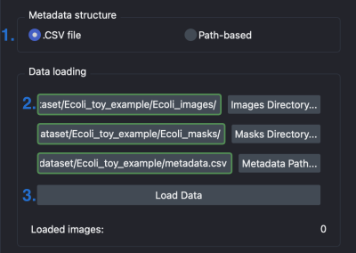
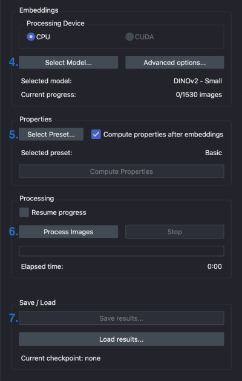
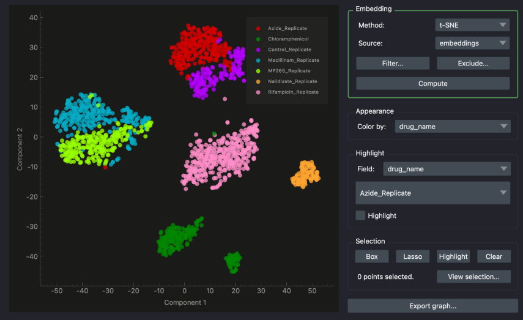

## PhenoMe GUI Tutorial

Here is a short step-by-step tutorial to extract embeddings from images using this plugin.
This shows the pipeline for a simple application; for more details about the possible options, see the [manual](MANUAL.md).

## Data Loading

1. Choose the correct metadata structure based on your dataset's file structure.

2. Drag and drop the folders containing the images, the masks, and the metadata CSV file into the text boxes, or browse for their directories.

3. Press **Load Data** to load the images. The corresponding data will be displayed in the data table:

## Image Processing

4. Select the embedding model you wish to use from the provided list.

5. Select the preset containing the properties you wish to extract.

6. Press **Process Images** to load the images. This may take a moment; the progress will be displayed in the progress bar.

7. Once the processing step is done, press **Save results...** to save the embeddings and properties in a .hdf5 file that can be loaded later.

## Analysis

Once the image processing step is done, you may proceed to the **analysis** panel.

This panel offers clustering and image retrieval tools, as well as an interactive explorer to visualize the results in 2D:

Press **Compute** to display the 2D scatterplot of the embeddings using the chosen dimensionality reduction **Method**.

Points can be filtered, highlighted and selected in various ways; see the [manual](MANUAL.md) for more details.